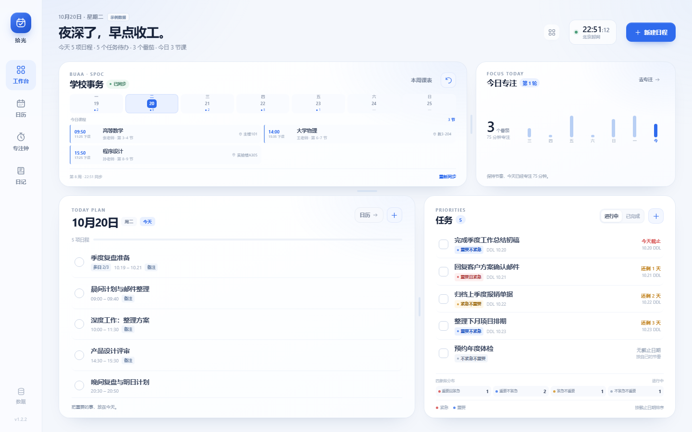

# 拾光

一款轻量、安静的日常办公工作台：日程、日历、四象限任务、番茄钟、专注统计、日记与北航 SPOC 课表，收在一个简洁的蓝色界面里。

仓库：<https://github.com/lvclengai/BUAAShiGuang>

更新记录：[CHANGELOG.md](CHANGELOG.md)



## 快速开始

### 本地服务（推荐）

双击 `start.cmd`，或在项目目录运行：

```powershell
node server.mjs
```

然后访问 <http://127.0.0.1:4173>。只需 Node.js 20+，无需安装依赖。

### 直接打开

双击 `index.html` 可以使用日程、任务、专注和日记等核心功能；学校课表同步需要本地服务，无法在纯静态页面中使用。

在 Chrome / Edge 中可将拾光安装为 PWA，离线使用核心功能。

## 学校课表

在工作台「学校事务」中连接北航统一认证，即可读取 SPOC 教学空间当前周的课程，并按天查看。

- 需要校园网或学校 VPN，并使用 `start.cmd` / `node server.mjs` 启动。
- 账号密码只用于本次同步：不写入 IndexedDB、备份或日志，同步结束后清空。
- 课表结果会缓存到本机，断网时仍可查看上次同步内容。
- 这是本地辅助功能，不是北航官方应用；验证码、二次验证或学校接口调整可能导致同步失败。
- GitHub Pages 等纯静态部署无法使用课表同步。

## 数据与隐私

- 数据保存在当前浏览器的 IndexedDB，可导出 / 导入 JSON 备份。
- 首次打开会载入示例数据，可在「数据」中清除。
- 除主动同步北航课表时与学校系统通信外，数据不会上传到第三方服务器。

## 项目结构

```text
.
├── index.html            # 页面结构
├── styles.css            # 样式与响应式布局
├── app.js                # 主应用逻辑
├── js/
│   ├── storage.js        # IndexedDB 存储层
│   ├── charts.js         # 专注统计 SVG 图表
│   └── layout.js         # 工作台可调整布局
├── school.mjs            # 北航统一认证 + SPOC 课表同步
├── server.mjs            # 本地静态服务与课表 API
├── sw.js                 # PWA 离线缓存
├── start.cmd             # Windows 一键启动
└── screenshots/          # 界面截图
```

## 兼容性

已在 Chrome / Edge（Chromium 内核）验证。建议使用较新的浏览器版本，并保持 Node.js 20 以上用于本地服务。

## 更新记录

版本变更请查看 [CHANGELOG.md](CHANGELOG.md)。
