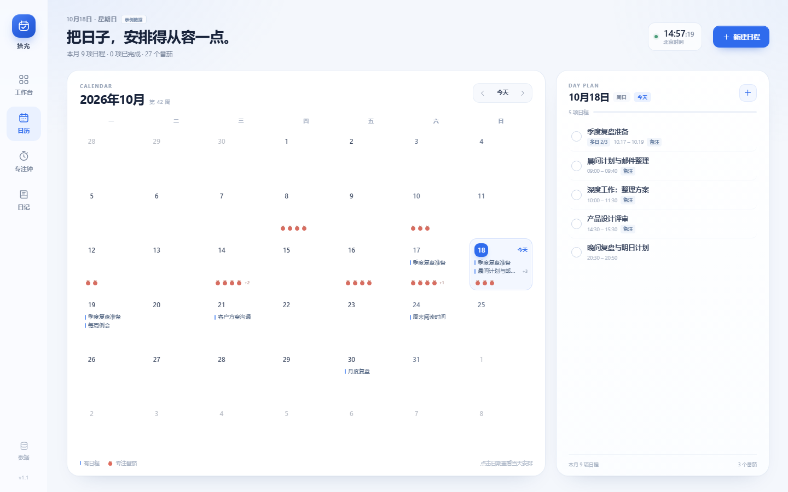
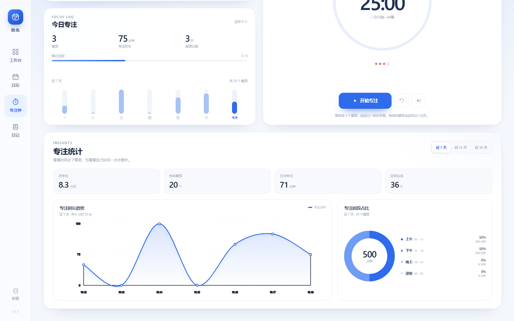
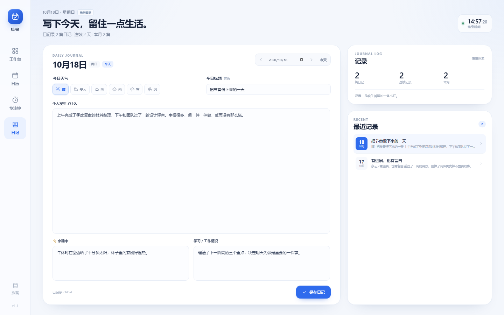
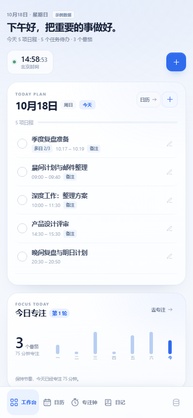

# 拾光 · 日常办公工作台

一款轻量、安静、专注的日常办公应用。工作台、独立日历、四象限任务、北京时间、番茄钟、专注统计和日记，都收在一个页面体系里。无需账号、无需联网，数据只保存在本机。

仓库地址：<https://github.com/lvclengai/BUAAShiGuang>  
更新记录：[CHANGELOG.md](CHANGELOG.md)


## v1.1 更新

- 日历从工作台拆分为独立板块，工作台保留今日日程与任务。
- 任务支持「无截止日期」，不设 DDL 的任务会排在清单末尾。
- 「专注钟」新增专注统计：时长趋势折线图、专注时段占比环图、总专注、日均、目标达成率。
- 新增「日记」板块：天气、今日标题、今天发生了什么、小确幸、学习 / 工作情况，支持自动保存和按日期回看。
- 数据存储从 `localStorage` 升级为 **IndexedDB**，可容纳更多日程、任务和日记，并自动迁移旧版本数据。

## 功能

### 工作台

- 今日日程：查看、添加、勾选完成、编辑和删除当天的日程。
- 任务清单：按四象限分类，支持可选 DDL、完成状态和进行中 / 已完成筛选。
- 今日专注快照：当天番茄数、专注分钟与近 7 天节奏。
- 四象限分布：随时看到进行中的任务在各优先级中的数量。

### 独立日历

- 月历切换、回到今天、点击日期查看当日安排。
- 新建 / 编辑 / 删除日程，支持**单日**和**多日**类型。
- 单日日程可设置可选时间段；多日日程会出现在区间内的每一天。
- 勾选日程即可完成，状态在所有日期中同步。
- 日历格直接显示日程摘要、完成状态与当天番茄数量；右侧保留当日日程面板和本月摘要。

### 四象限任务

- 「重要且紧急 / 重要不紧急 / 紧急不重要 / 不紧急不重要」四类。
- 每项任务可以设置 DDL，也可以选择**无截止日期**。
- 主界面实时显示「还剩 N 天 / 今天截止 / 已逾期 N 天 / 无截止日期」。
- 有 DDL 的任务按截止日期排序，无 DDL 的任务排在清单末尾。
- 支持新建、编辑、删除，以及进行中 / 已完成筛选。

### 北京时间与番茄钟

- 顶栏常驻北京时间，专注页提供大号时钟与当日时间进度。
- 25 分钟专注 + 5 分钟短休息 + 15 分钟长休息，每完成 4 个番茄推荐一次长休息。
- 完成的番茄会自动记入当天，并在日历中显示为番茄图标。
- 专注统计支持近 7 / 14 / 30 天切换：
  - 总专注时长、完成番茄、日均专注、目标达成率；
  - 专注时长趋势折线图；
  - 上午 / 下午 / 晚上 / 深夜的专注时段占比环图。

### 日记

- 按日期记录，每天一篇，可前后翻日或直接选择日期。
- 记录今日天气、今日标题、今天发生了什么、小确幸、学习 / 工作情况。
- 输入后自动保存，也可以手动保存；顶部显示保存状态和时间。
- 右侧显示总篇数、连续记录、本月篇数以及最近记录，点击可跳转回看。

### 数据与轻量

- 纯 HTML / CSS / JavaScript，零运行时依赖。
- 使用 IndexedDB 本地数据库，比 `localStorage` 容量更大；首次打开会自动迁移旧数据。
- 支持导出 / 导入 JSON 备份（最多 50MB），换设备前可完整带走日程、任务、番茄记录和日记。
- 支持 PWA 离线缓存，可安装为桌面应用。
- 所有数据只在本机，不上传服务器。

## 快速开始

### 方式一：本地服务（推荐）

Windows 下双击 `start.cmd`，会在 `http://127.0.0.1:4173` 启动并打开应用。

也可以在项目目录中运行：

```powershell
node server.mjs
```

然后访问 <http://127.0.0.1:4173>。

> `server.mjs` 只使用 Node.js 内置模块，不需要安装依赖。需要 Node.js 18 或更高版本。

### 方式二：直接打开

直接双击 `index.html` 也可以使用核心功能。此时浏览器不会注册离线缓存，建议通过本地服务访问以获得完整 PWA 体验。

### 安装为桌面应用

在 Chrome / Edge 打开应用后，点击地址栏右侧的「安装」图标，或打开浏览器菜单选择「安装拾光」。安装后可从桌面或开始菜单启动，并支持离线使用。

## 快捷键

- 在「专注钟」页面，按 `空格` 开始 / 暂停计时（焦点不在输入框或按钮上时）。
- `Esc` 关闭当前弹窗。

## 数据说明

- 所有内容保存在当前浏览器的 IndexedDB 中，不会上传到任何服务器。
- 第一次打开时会载入一组**示例数据**，方便快速了解界面；点击顶部的「示例数据」或导航中的「数据」即可打开设置并清空。
- 旧版本使用 `localStorage` 的数据会在首次打开 v1.1 时自动迁移到 IndexedDB，并移除旧存储。
- 如果浏览器不支持 IndexedDB，会自动回退到兼容存储模式。
- 换浏览器、清理浏览器站点数据或更换设备前，请在「数据与设置」中导出备份。
- 导入备份会替换当前全部数据，操作前会二次确认。

## 文件结构

```text
.
├── index.html             # 页面结构
├── styles.css             # 视觉样式与响应式布局
├── app.js                 # 日历、任务、时钟、番茄钟、统计、日记与存储逻辑
├── sw.js                  # 离线缓存 Service Worker
├── manifest.webmanifest   # PWA 清单
├── server.mjs             # 零依赖本地静态服务器
├── start.cmd              # Windows 一键启动
├── icons/                 # 应用图标
└── screenshots/           # 界面截图
```

## 设计

- 以克制的蓝色（`#2f6bed`）为主色，搭配浅灰蓝背景与大量留白。
- 系统字体、低对比边框、轻阴影，不依赖网络字体与第三方 UI 库。
- 桌面为多栏工作区，窄屏自动切换为单栏和底部导航。

## 兼容性

已在 Chrome / Edge（Chromium 内核）中验证。使用现代 JavaScript、CSS、IndexedDB 与 `<dialog>`，建议保持浏览器为较新版本。

## 截图

独立日历：



专注统计：



日记：



手机视图：


